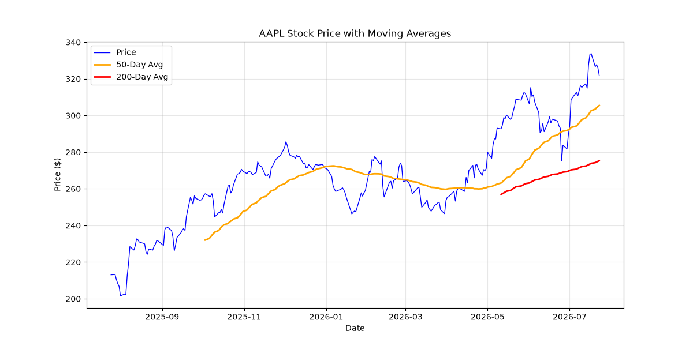

# Financial Data Analyser

A Python tool that fetches and analyses stock data with moving averages.

## Features

- Fetches 1 year of stock data using yfinance API
- Calculates 50-day and 200-day Simple Moving Averages (SMA)
- Computes daily returns and volatility
- Generates professional charts with all 3 lines
- Exports data to CSV for further analysis

## Tech Stack

| Tool | Purpose |
|------|---------|
| Python 3 | Programming language |
| yfinance | Fetch stock data from Yahoo Finance |
| pandas | Data processing and analysis |
| matplotlib | Data visualisation |
| tabulate | Pretty table formatting |

---

## How It Works: Key Concepts Explained

### What is SMA (Simple Moving Average)?

**SMA** stands for **Simple Moving Average**. It's the average price of a stock over a specific number of days.

**How it's calculated:**

**SMA** = (Price Day 1 + Price Day 2 + ... + Price Day N) ÷ N

**Example:**
- Day 1: $100, Day 2: $102, Day 3: $101
- 3-day SMA = ($100 + $102 + $101) ÷ 3 = $101

**Why it matters:**
- Smooths out daily price fluctuations
- Helps identify the overall trend
- 50-day SMA = short-term trend
- 200-day SMA = long-term trend

### Why Use Closing Price?

**The closing price** is the final price of a stock at the end of each trading day.

**Why we use it:**
- It's the most widely quoted price
- It reflects the final sentiment of the day
- It's the price used in most financial analysis
- It's consistent — every stock has a closing price

**Other prices (Open, High, Low) are useful, but closing price is the industry standard for trend analysis.**

### What is Volatility?

**Volatility** measures how much a stock's price moves up and down.

**How it's calculated:**
- We calculate the daily percentage change for each day
- Then we take the **standard deviation** of those changes
- Higher standard deviation = more volatility

**What it tells you:**
| Volatility | Meaning |
|------------|---------|
| **Low (e.g., 1%)** | Stock is stable, price moves slowly |
| **High (e.g., 5%)** | Stock is risky, price swings a lot |

**Example:**
- A stock with 1% volatility moves about ±1% on average each day
- A stock with 5% volatility moves about ±5% on average each day

### What Does `.iloc` Do in the Code?

**`.iloc`** is a pandas function that selects rows by their **position** (like an index).

| Code | What it does |
|------|--------------|
| `data.iloc[0]` | Gets the **first** row of data |
| `data.iloc[5]` | Gets the **6th** row |
| `data.iloc[-1]` | Gets the **last** row |
| `data.iloc[-2]` | Gets the **second-to-last** row |
| `data['Close'].iloc[-1]` | Gets the **last** closing price |

**Why we use `.iloc[-1]`:**
- We want the **most recent** price
- `-1` always gives the last row, regardless of how much data we have
- This way we don't need to know the exact row number

**Difference between `.iloc` and `.loc`:**
| Function | Selects by |
|----------|------------|
| `.iloc` | **Position** (e.g., first row, last row) |
| `.loc` | **Label** (e.g., date like "2026-07-23") |

### What Does `.std()` Do?

**`.std()`** calculates the **standard deviation** of a set of numbers.

**In plain English:** It tells you how spread out the numbers are.

**Example:**
| Set of Numbers | Standard Deviation |
|----------------|-------------------|
| 100, 101, 102, 99, 100 | Low (numbers are close together) |
| 100, 150, 50, 200, 75 | High (numbers are spread out) |

**In our project:**
- We calculate daily returns (percentage changes)
- `.std()` measures how much these returns vary
- This gives us **volatility**

### Understanding the Moving Averages Chart

The chart shows three lines:

| Line | What It Represents |
|------|-------------------|
| **Blue (Price)** | Daily closing price — the most jagged line |
| **Orange (50-Day SMA)** | Average of last 50 days — smoother than price |
| **Red (200-Day SMA)** | Average of last 200 days — the smoothest line |

**What to look for:**
| Signal | Meaning |
|--------|---------|
| Price > 50-Day > 200-Day | Strong uptrend (bullish) |
| Price < 50-Day < 200-Day | Strong downtrend (bearish) |
| 50-Day crosses above 200-Day | "Golden Cross" → potential uptrend |
| 50-Day crosses below 200-Day | "Death Cross" → potential downtrend |

**Why the 200-Day line is the smoothest:**
- It averages 200 days of data
- This removes most daily "noise"
- It shows the **long-term** trend

---


## Sample Output

### Chart



*Apple stock price with 50-day and 200-day moving averages*

### Summary Output


## How to Run

### Prerequisites

- Python 3.8 or higher
- Internet connection (to fetch stock data)

### Installation

1. Clone the repository:
   ```bash
   git clone https://github.com/Rads9310/financial-analyser.git
   cd financial-analyser

2. Install dependencies:
   ```bash
   pip install yfinance pandas matplotlib tabulate
  
3. Run the script:
   ```bash
   python analyser.py

---
## 📁 Output Files

| File | Description |
|------|-------------|
| AAPL_analysis.png | Stock chart with moving averages |
| AAPL_data.csv | Full dataset with calculated metrics |

---

# 🔧 Customisation

To analyse a different stock, change the symbol variable in analyser.py:
- symbol = 'AMZN' # Amazon
- symbol = 'GOOGL' # Google
- symbol = 'TSLA' # Tesla
- symbol = 'MSFT' # Microsoft

To analyse a different time period, change the period parameter:
- data = stock.history(period="1mo") # 1 month
- data = stock.history(period="3mo") # 3 months
- data = stock.history(period="6mo") # 6 months
- data = stock.history(period="1y") # 1 year
- data = stock.history(period="5y") # 5 years

---

## Author

**Radhika S**

- GitHub: [github.com/Rads9310](https://github.com/Rads9310)


---

## Acknowledgements

- [yfinance](https://github.com/ranaroussi/yfinance) for providing stock data
- [pandas](https://pandas.pydata.org/) for data processing
- [matplotlib](https://matplotlib.org/) for visualisation

---

## Key Takeaways

| Concept | Simple Explanation |
|---------|-------------------|
| SMA | Average price over X days — smooths out noise |
| Closing Price | Standard price used in most analysis |
| Volatility | How much the price moves (risk indicator) |
| .iloc | Selects rows by position (e.g., first, last) |
| .std() | Measures how spread out numbers are |
| 50-Day SMA | Short-term trend (2-3 months) |
| 200-Day SMA | Long-term trend (1 year) |


